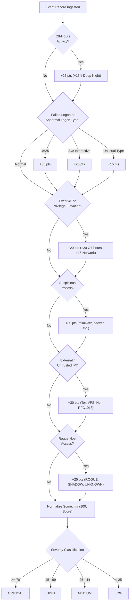
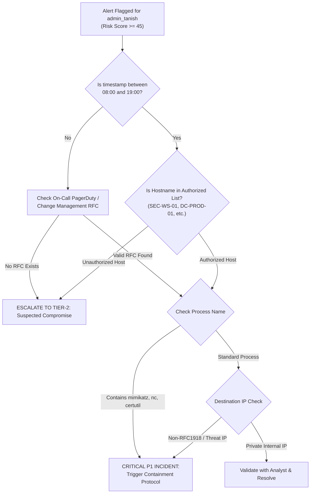
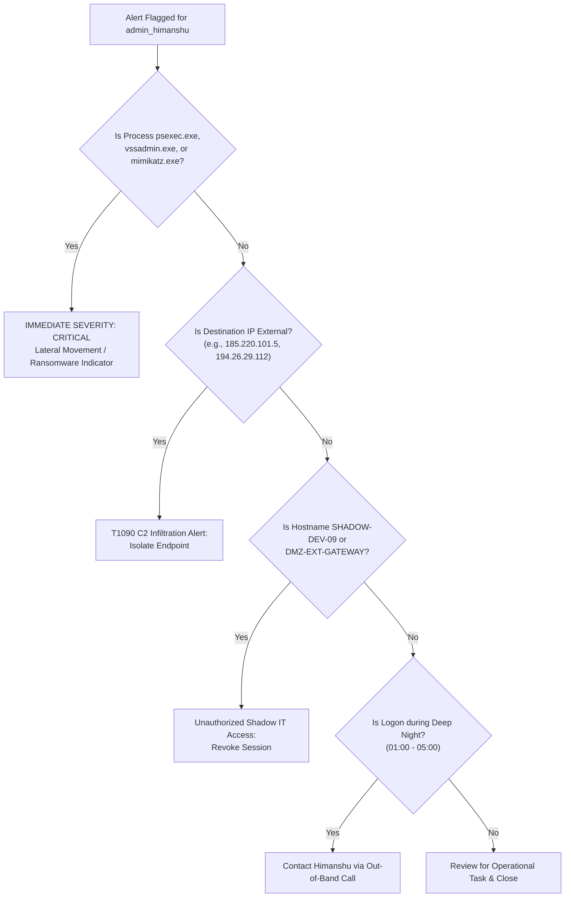
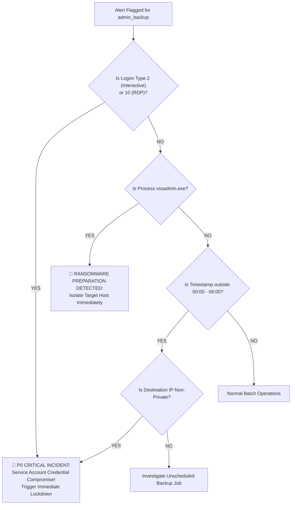

# PrivGuard: SOC Triage & Threat Hunting Investigation Playbook
## Production Playbook: Privileged Account Anomaly Detection & Incident Response

```
Document Reference : PRIVGUARD-SOP-SOC-001
Classification     : Restricted / SOC Internal Operations
Effective Date     : October 2026
Target Audience    : Tier-1 / Tier-2 / Tier-3 SOC Analysts, Threat Hunters, Incident Responders
Compliance Aligned : NIST SP 800-61 Rev. 2, MITRE ATT&CK for Enterprise
```

---

## 📑 Table of Contents

1. [Executive Summary & Purpose](#1-executive-summary--purpose)
2. [MITRE ATT&CK® Mapping Matrix](#2-mitre-attck-mapping-matrix)
3. [Windows Security Event ID Analysis Matrix](#3-windows-security-event-id-analysis-matrix)
   - [Event ID 4624: Successful Logon](#event-id-4624-successful-logon-in-depth)
   - [Event ID 4625: Failed Logon](#event-id-4625-failed-logon-in-depth)
   - [Event ID 4672: Special Privileges Assigned](#event-id-4672-special-privileges-assigned-in-depth)
4. [PrivGuard Multi-Factor Risk Scoring Engine](#4-privguard-multi-factor-risk-scoring-engine)
5. [Persona Threat Profiles & Triage Workflows](#5-persona-threat-profiles--triage-workflows)
   - [Persona 1: admin_tanish (SecOps / Security Engineering)](#51-persona-admin_tanish-secops--security-engineering)
   - [Persona 2: admin_himanshu (Infrastructure & Network Admin)](#52-persona-admin_himanshu-infrastructure--network-admin)
   - [Persona 3: admin_backup (Service Account / Automated Tasks)](#53-persona-admin_backup-service-account--automated-tasks)
6. [Incident Escalation & SLA Matrix](#6-incident-escalation--sla-matrix)
7. [Containment, Remediation & Isolation Protocols](#7-containment-remediation--isolation-protocols)
   - [Active Directory Account Containment](#step-1-active-directory-account-containment)
   - [Host Network Isolation Protocols](#step-2-host-network-isolation-protocols)
   - [Kerberos Ticket Invalidation & Credential Reset](#step-3-kerberos-ticket-invalidation--credential-reset)
   - [Automated Threat Hunting Scripts](#step-4-automated-threat-hunting-scripts)
8. [Post-Incident Review & Evidence Preservation](#8-post-incident-review--evidence-preservation)

---

## 1. Executive Summary & Purpose

The **PrivGuard Investigation Playbook** provides a battle-tested standard operating procedure (SOP) for Security Operations Center (SOC) personnel investigating alerts generated by the PrivGuard Privileged Account Anomaly Detection Engine.

Privileged accounts—human administrators and non-human service accounts—possess the credentials necessary to perform lateral movement, disable security controls, dump password hashes from LSASS, and execute ransomware. This playbook equips analysts with the exact technical criteria, forensic steps, and containment scripts required to rapidly assess, contain, and eradicate threats involving privileged identity abuse.

---

## 2. MITRE ATT&CK® Mapping Matrix

PrivGuard detects behaviors aligned across the following techniques in the **MITRE ATT&CK Matrix for Enterprise**:

| ATT&CK ID | Technique Name | Tactic | PrivGuard Indicator / Detection Rule |
| :--- | :--- | :--- | :--- |
| **T1078.002** | Valid Accounts: Domain Accounts | Initial Access, Persistence, Privilege Escalation | Anomalous privileged logon by `admin_tanish`, `admin_himanshu` outside business hours. |
| **T1078.003** | Valid Accounts: Local Accounts | Defense Evasion, Persistence | Interactive desktop logons using service account `admin_backup`. |
| **T1021.001** | Remote Services: Remote Desktop Protocol (RDP) | Lateral Movement | Logon Type 10 assigned to human accounts during deep night (01:00–05:00). |
| **T1021.002** | Remote Services: SMB/Windows Admin Shares | Lateral Movement | Logon Type 3 network elevation paired with `psexec.exe` execution. |
| **T1059.001** | Command & Scripting Interpreter: PowerShell | Execution | Uncharacteristic PowerShell sessions on domain controllers. |
| **T1059.003** | Command & Scripting Interpreter: Windows Command Shell | Execution | `cmd.exe` executing with high privilege token (`4672`) on sensitive production hosts. |
| **T1003.001** | OS Credential Dumping: LSASS Memory | Credential Access | Execution of `mimikatz.exe` accompanied by `SeDebugPrivilege` assignment. |
| **T1490** | Inhibit System Recovery | Impact | Execution of `vssadmin.exe` (Volume Shadow Copy deletion). |
| **T1090.003** | Proxy: Multi-hop Proxy | Command and Control | Network egress to known Tor exit nodes (e.g., `185.220.101.5`). |
| **T1105** | Ingress Tool Transfer | Command and Control | `certutil.exe` execution connecting to external VPS (`45.33.32.156`). |
| **T1569.002** | System Services: Service Execution | Execution | Service control execution via `psexec.exe` or `net1.exe`. |

---

## 3. Windows Security Event ID Analysis Matrix

### Event ID 4624: Successful Logon (In-Depth)

Event ID 4624 is logged whenever an account successfully authenticates to a local computer or domain resource. When auditing privileged accounts, **Logon Type** is the primary discriminant between legitimate operations and unauthorized access.

#### Logon Type Taxonomy & PrivGuard Evaluation

| Logon Type | Name | Expected Privileged Context | High-Risk Threat Indicators |
| :---: | :--- | :--- | :--- |
| **2** | **Interactive** | Physical console logon at authorized workstation (`SEC-WS-01`, `INFRA-WS-02`). | **CRITICAL**: Observed on service account `admin_backup`. Interactive logons on headless service accounts indicate credential theft or rogue terminal access. |
| **3** | **Network** | Connecting to shared resources (SMB, RPC, WinRM, IIS, DFS) from an internal IP. | **HIGH**: Receiving elevated rights (`4672`) over network logon (`NETWORK_PRIVILEGE_ASSIGNMENT`), or connecting from an external/untrusted IP address. |
| **4** | **Batch** | Scheduled tasks (e.g., scheduled backup task executing under `admin_backup`). | **HIGH**: Observed on human administrator personas (`admin_tanish`, `admin_himanshu`), suggesting persistence via scheduled task backdoors. |
| **5** | **Service** | Background service startup initiated by the Service Control Manager (SCM). | Normal for `admin_backup` (`services.exe`). Suspicious if associated with human accounts without prior software deployment tickets. |
| **10** | **RemoteInteractive (RDP)** | Remote desktop connections through Terminal Services from authorized subnets. | **CRITICAL**: RDP logon occurring during deep night (01:00–05:00), originating from external VPS or rogue laptops (`ROGUE-LAPTOP-X`). |

#### Key Forensic XML Fields for Event 4624
```xml
<EventData>
  <Data Name="SubjectUserName">-</Data>
  <Data Name="TargetUserName">admin_backup</Data>
  <Data Name="TargetDomainName">CORP</Data>
  <Data Name="LogonType">2</Data> <!-- CHECK LOGON TYPE -->
  <Data Name="WorkstationName">ROGUE-LAPTOP-X</Data> <!-- CHECK FOR ROGUE HOST -->
  <Data Name="IpAddress">185.220.101.5</Data> <!-- CHECK FOR EXTERNAL / TOR IP -->
  <Data Name="IpPort">49872</Data>
  <Data Name="ProcessName">C:\Windows\System32\winlogon.exe</Data>
</EventData>
```

---

### Event ID 4625: Failed Logon (In-Depth)

Event ID 4625 indicates an authentication failure. In privileged monitoring, failed logons often precede credential stuffing, password guessing, or expired ticket abuse.

#### Critical Status and Substatus Codes

| Status Code | Substatus Code | Error Meaning | Triage Action |
| :--- | :--- | :--- | :--- |
| `0xC000006D` | `0xC000006A` | Bad username or password. | Check volume: >5 attempts within 2 minutes indicates brute-force or password spray. |
| `0xC000006D` | `0xC000006E` | User workstation restriction violation. | Attacker attempted to use valid credentials on an unauthorized endpoint. |
| `0xC000006D` | `0xC000006F` | User logon time restriction violation. | Account used outside permitted GPO active logon hours. High-fidelity off-hours indicator. |
| `0xC000006D` | `0xC0000072` | Account is disabled. | Attacker attempting to activate a dormant or disabled administrative account. |
| `0xC0000234` | `0x0` | User account currently locked out. | Account locked due to failed attempt threshold; verify if attacker triggered threshold during spraying. |

> [!IMPORTANT]
> If a burst of Event 4625 failures is immediately followed by a single Event 4624 and Event 4672, treat as an **active brute-force compromise** requiring immediate account disablement.

---

### Event ID 4672: Special Privileges Assigned (In-Depth)

Event ID 4672 is logged in security logs on the system where logon occurs whenever sensitive administrative privileges are assigned to a new user session.

#### High-Risk Windows Privileges Monitored by PrivGuard

| Assigned Privilege | Windows Constant | Exploitation Risk & Impact |
| :--- | :--- | :--- |
| **SeDebugPrivilege** | `SeDebugPrivilege` | Allows attaching a debugger to any process. Prerequisite for memory dumping tools (`mimikatz.exe`) to read plaintext credentials from `lsass.exe`. |
| **SeTcbPrivilege** | `SeTcbPrivilege` | "Act as part of the operating system." Allows arbitrary token creation and impersonation. |
| **SeBackupPrivilege** | `SeBackupPrivilege` | Bypasses all filesystem read permissions. Allows copying `NTDS.dit` or SAM database files directly from disk. |
| **SeRestorePrivilege** | `SeRestorePrivilege` | Bypasses all filesystem write permissions. Enables overwriting protected system binaries (`sethc.exe`, `utilman.exe`). |
| **SeTakeOwnershipPrivilege** | `SeTakeOwnershipPrivilege` | Allows taking ownership of any securable object, including registry hives and Active Directory containers. |
| **SeImpersonatePrivilege** | `SeImpersonatePrivilege` | Allows impersonating client security contexts (abused in Potato-style local privilege escalations). |

---

## 4. PrivGuard Multi-Factor Risk Scoring Engine

PrivGuard assigns a composite risk score ($0 - 100$) by evaluating additive behavioral vectors against baseline persona profiles:



### Risk Scoring Rules Matrix

| Rule Identifier | Trigger Condition | Weight | Rationale |
| :--- | :--- | :---: | :--- |
| `OFF_HOURS_ACTIVITY` | Event timestamp outside persona `active_hours`. | **+25** | Unscheduled access outside standard operational shift. |
| `DEEP_NIGHT_HUMAN_LOGON` | Human admin logging in between 01:00 and 05:00. | **+15** | Peak adversary operating window; low human oversight. |
| `FAILED_LOGON_EVENT_4625` | Event ID equals 4625. | **+35** | Authentication failure indicating bad credentials or policy block. |
| `ABNORMAL_INTERACTIVE_SERVICE_LOGON` | `admin_backup` receiving Logon Type 2 or 10. | **+25** | Headless automated service accounts must never log in interactively. |
| `UNUSUAL_LOGON_TYPE` | Logon type not in persona's standard set. | **+15** | Anomaly in protocol/logon mechanism. |
| `PRIVILEGE_GRANT_EVENT_4672` | Event ID equals 4672. | **+20** | Assignment of sensitive admin security tokens. |
| `OFF_HOURS_PRIVILEGE_ELEVATION` | Event 4672 occurring during off-hours. | **+20** | High-probability indicator of compromised credential elevation. |
| `NETWORK_PRIVILEGE_ASSIGNMENT` | Event 4672 assigned over Logon Type 3 (Network). | **+15** | Lateral movement via SMB/RPC or remote command execution. |
| `SUSPICIOUS_PROCESS_<NAME>` | Process in `SUSPICIOUS_PROCESS_LIST`. | **+35** | Dual-use offensive tools (`mimikatz`, `psexec`, `vssadmin`, `nc`). |
| `UNTRUSTED_EXTERNAL_IP` | Destination IP is non-private or in known threat list. | **+30** | Egress/ingress to external Tor exit node, foreign host, or VPS. |
| `ROGUE_HOST_ACCESS` | Hostname contains `ROGUE`, `SHADOW`, `UNKNOWN`, `DMZ-EXT`. | **+25** | Activity on unmanaged, non-domain-joined, or untrusted endpoints. |
| `UNAUTHORIZED_HOSTNAME` | Hostname not in persona's `authorized_hosts`. | **+20** | Lateral movement to unauthorized server or subnet. |

---

## 5. Persona Threat Profiles & Triage Workflows

---

### 5.1. Persona: `admin_tanish` (SecOps / Security Engineering)

#### Persona Baseline Profile
- **Role**: Senior Security Operations & Engineering Administrator
- **Active Operational Hours**: **08:00 – 19:00** (Daytime Shift)
- **Authorized Workstations & Servers**:
  - `SEC-WS-01` (Primary SecOps Workstation)
  - `DC-PROD-01` (Primary Domain Controller)
  - `SEC-MGMT-02` (Security Management Server)
  - `SIEM-COLLECTOR-01` (SIEM Ingestion Gateway)
- **Standard Process Whitelist**: `powershell.exe`, `mmc.exe`, `mstsc.exe`, `explorer.exe`, `svchost.exe`
- **Standard Logon Types**: `2` (Interactive), `10` (RDP), `3` (Network)

#### Primary Threat Scenarios
1. **Off-Hours Privilege Assignment**: `admin_tanish` logging in at 02:30 AM with Event 4672 on `DC-PROD-01`.
2. **Dual-Use Tool Abuse**: Execution of `nc.exe` (Netcat reverse shell) or `certutil.exe` (file download bypass) on `SEC-MGMT-02`.
3. **Rogue Endpoint Access**: Authentication originating from `ROGUE-LAPTOP-X` or `DMZ-EXT-GATEWAY`.

#### Step-by-Step Triage Workflow for `admin_tanish`



#### Analyst Verification Checklist
- [ ] Cross-reference ServiceNow / Jira ITSM for active Emergency Change Requests (ECRs).
- [ ] Check Slack `#secops-alerts` or PagerDuty schedule: Was Tanish on active incident response duty?
- [ ] Inspect parent process (`ProcessName`) and full command line via EDR telemetry (e.g., did `cmd.exe` spawn `nc.exe`?).
- [ ] Inspect destination IP against VirusTotal, AbuseIPDB, and internal threat intelligence feeds.

---

### 5.2. Persona: `admin_himanshu` (Infrastructure & Network Admin)

#### Persona Baseline Profile
- **Role**: Infrastructure, Systems & Virtualization Administrator
- **Active Operational Hours**: **09:00 – 21:00** (Extended Engineering Shift)
- **Authorized Workstations & Servers**:
  - `INFRA-WS-02` (Primary Systems Engineering Station)
  - `DC-PROD-02` (Secondary Domain Controller)
  - `APP-SRV-01` (Core Application Server)
  - `DB-SRV-02` (Database Server)
- **Standard Process Whitelist**: `pwsh.exe`, `cmd.exe`, `ServerManager.exe`, `vmware-vmx.exe`, `explorer.exe`
- **Standard Logon Types**: `2` (Interactive), `3` (Network), `10` (RDP)

#### Primary Threat Scenarios
1. **Lateral Movement via PsExec**: `admin_himanshu` invoking `psexec.exe` to spawn remote shells on `DC-PROD-02` or `APP-SRV-01` over Logon Type 3.
2. **External C2 Beaconing**: Egress connections to foreign VPS infrastructure (`194.26.29.112`, `103.208.220.122`).
3. **Shadow Endpoint Infiltration**: Connecting to unauthorized endpoints such as `SHADOW-DEV-09`.

#### Step-by-Step Triage Workflow for `admin_himanshu`



#### Analyst Verification Checklist
- [ ] Determine if `psexec.exe` or `ServerManager.exe` was invoked with remote service installation arguments (`-s`, `-accepteula`).
- [ ] Query firewall logs for egress traffic volume to destination IP within $\pm 30$ minutes of the alert.
- [ ] Verify if `SHADOW-DEV-09` is an unmanaged rogue asset or newly provisioned staging VM.

---

### 5.3. Persona: `admin_backup` (Service Account / Automated Tasks)

#### Persona Baseline Profile
- **Role**: Automated Enterprise Backup Service Principal (Headless)
- **Active Operational Hours**: **00:00 – 06:00 (Midnight Batch Window Only)**
- **Authorized Workstations & Servers**:
  - `BKP-SRV-01` (Dedicated Enterprise Backup Server)
  - `STORAGE-NAS-01` (Network Attached Storage Appliance)
  - `DC-PROD-01` (Domain Controller Backup Agent Target)
  - `DB-SRV-01` (Database Snapshot Host)
- **Standard Process Whitelist**: `wbengine.exe`, `backupagent.exe`, `powershell.exe`, `robocopy.exe`, `services.exe`
- **Standard Logon Types**: `4` (Batch Task), `5` (Windows Service), `3` (Network Share)
- **EXPLICIT PROHIBITION**: **Logon Type 2 (Interactive) and Logon Type 10 (Remote Desktop) are STRICTLY FORBIDDEN.**

#### Primary Threat Scenarios
1. **Interactive Desktop Hijacking**: Any interactive logon (Logon Type 2 or 10) on `admin_backup` indicates that an adversary has stolen the service account credentials and is using them for human navigation.
2. **Shadow Copy Annihilation**: Execution of `vssadmin.exe` (`vssadmin delete shadows /all /quiet`) to disable disaster recovery before deploying ransomware.
3. **Midday Anomaly Spikes**: Backups running at 14:00 (outside the midnight batch window) executing `net1.exe` or `certutil.exe`.

#### Step-by-Step Triage Workflow for `admin_backup`



#### Analyst Verification Checklist
- [ ] **Check Logon Type immediately**: If `LogonType == 2` or `LogonType == 10`, escalate to **Priority 1 (Critical)**.
- [ ] Check whether Volume Shadow Copies exist: Run `vssadmin list shadows` on target host.
- [ ] Check whether password was recently changed in Active Directory or extracted via Kerberoasting.

---

## 6. Incident Escalation & SLA Matrix

PrivGuard aligns with industry-standard Incident Response SLAs based on normalized risk severity:

| Severity Level | Normalized Risk Score | Response SLA | Target Containment SLA | Primary Escalation Path |
| :--- | :---: | :---: | :---: | :--- |
| **CRITICAL** | **70 – 100** | **< 15 minutes** | **< 30 minutes** | Tier-3 SOC Lead, Incident Commander, CISO On-Call |
| **HIGH** | **45 – 69** | **< 30 minutes** | **< 60 minutes** | Tier-2 Senior Security Analyst, Active Directory Team |
| **MEDIUM** | **25 – 44** | **< 2 hours** | **< 4 hours** | Tier-1 / Tier-2 Security Analyst |
| **LOW** | **0 – 24** | **< 24 hours** | N/A (Informational) | SOC Queue / Automated Aggregation |

---

## 7. Containment, Remediation & Isolation Protocols

When an alert confirms unauthorized privileged activity, follow the four containment steps below in strict chronological sequence.

### Step 1: Active Directory Account Containment

Execute containment immediately via Active Directory Administrative PowerShell:

```powershell
# 1. Immediately disable the compromised privileged account
Disable-ADAccount -Identity "admin_tanish"

# 2. Terminate all active sessions by resetting account lockout and setting expiration to past
Set-ADUser -Identity "admin_tanish" -AccountExpirationDate (Get-Date).AddDays(-1)

# 3. Add account to Protected Users group to restrict delegation and NTLM caching
Add-ADGroupMember -Identity "Protected Users" -Members "admin_tanish"

# 4. Clear all Kerberos Ticket Granting Tickets (TGT) for the user across the domain
Revoke-ADKerberosTicket -Identity "admin_tanish" -ErrorAction SilentlyContinue

Write-Host "[+] Account admin_tanish successfully isolated in Active Directory." -ForegroundColor Green
```

### Step 2: Host Network Isolation Protocols

Isolate the compromised host (`ROGUE-LAPTOP-X`, `SEC-MGMT-02`, etc.) to prevent lateral spread:

```powershell
# Windows Defender Firewall emergency network containment (Allow only SOC management IP)
$SOC_MGMT_IP = "10.10.10.25"

# Block all inbound traffic except SOC management
New-NetFirewallRule -DisplayName "EMERGENCY_ISOLATION_IN" `
    -Direction Inbound -Action Block -Profile Any -Priority 1

# Block all outbound traffic except to SOC management IP
New-NetFirewallRule -DisplayName "EMERGENCY_ISOLATION_OUT" `
    -Direction Outbound -Action Block -Profile Any -Priority 1

# Allow SOC management bypass
New-NetFirewallRule -DisplayName "EMERGENCY_ALLOW_SOC" `
    -Direction Inbound -Action Allow -RemoteAddress $SOC_MGMT_IP -Priority 2

Write-Host "[+] Host network containment rules applied successfully." -ForegroundColor Yellow
```

### Step 3: Kerberos Ticket Invalidation & Credential Reset

If a Domain Admin account (`admin_tanish`, `admin_himanshu`) was compromised, Kerberos Golden Ticket attacks may be staged.

1. **Purge Local Kerberos Tickets**:
   ```cmd
   klist purge
   ```
2. **Execute Double Reset of the `krbtgt` Account**:
   * Resetting the `krbtgt` password twice invalidates all forged Kerberos TGTs across the forest while allowing replication.
   * Use the Microsoft-recommended script: `New-KrbtgtKeys.ps1`.
3. **Reset Privileged Credentials via LAPS / PAM**:
   * Generate a randomized 32-character password via Privileged Access Management (PAM) vault.
   * Enforce FIDO2 / hardware token MFA on next logon.

### Step 4: Automated Threat Hunting Scripts

Search the October 2026 telemetry baseline for additional persistence artifacts:

```powershell
# Search raw log baseline for lateral movement from the same destination IP
$THREAT_IP = "185.220.101.5"
Import-Csv "synthetic_privileged_logs.csv" | Where-Object {
    $_.destination_ip -eq $THREAT_IP
} | Format-Table timestamp, username, hostname, process_name, event_id -AutoSize

# Search for Volume Shadow Copy manipulation attempts across all users
Import-Csv "synthetic_privileged_logs.csv" | Where-Object {
    $_.process_name -match "vssadmin|mimikatz|certutil"
} | Select-Object timestamp, username, hostname, process_name, is_forced_anomaly | Format-Table -AutoSize
```

---

## 8. Post-Incident Review & Evidence Preservation

Following incident containment:

1. **Volatile Artifact Preservation**:
   - Capture memory dump of target host prior to reboot (`winpmem.exe` or DumpIt).
   - Export Windows Security Event Log:
     ```powershell
     wevtutil epl Security "C:\Forensics\SecurityLog_Compromise.evtx"
     ```
2. **Root Cause Analysis (RCA)**:
   - Determine initial vector: Phishing, unpatched vulnerability, public exposure of RDP, or credential stuffing.
3. **Engine Calibration & Tuning**:
   - If an operational false positive occurred, adjust `PERSONA_PROFILES` in `detect_anomalies.py` (e.g., update `authorized_hosts` or `active_hours` to reflect documented shift changes).
4. **Final Sign-Off**:
   - Incident Commander and Identity Team Lead must formally sign off prior to re-enabling accounts.

---

```
Document Approved by : Head of Security Operations (SecOps)
Document Maintained by: PrivGuard Detection Engineering Team
Playbook Version     : 2.4.0 (Enterprise SOC Edition)
```
