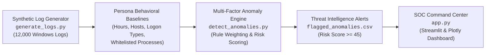

# PrivGuard: Privileged Account Anomaly Monitor

<div align="center">

[](https://privguard-anomaly-monitor.streamlit.app)


**Autonomous Identity Threat Detection and Response (ITDR) & Security Operations Center (SOC) Command Center**

🌐 **Live Production Demo**: [https://privguard-anomaly-monitor.streamlit.app](https://privguard-anomaly-monitor.streamlit.app)

</div>

---

## 📌 Executive Overview

In modern enterprise architectures, **Tier-0 and Tier-1 Privileged Accounts** (Domain Admins, SecOps Engineers, and Service Principals) are the primary targets for Advanced Persistent Threats (APTs), ransomware operators, and insider threats. Attackers rarely deploy noisy, traditional exploits once administrative access is obtained; instead, they **"Live off the Land" (LotL)** using native administrative binaries (`powershell.exe`, `cmd.exe`, `psexec.exe`, `certutil.exe`) and valid credentials to traverse networks undetected.

**PrivGuard (Privileged Account Anomaly Monitor)** is an enterprise-grade Identity Threat Detection and Response (ITDR) analytics platform that continuously audits, models, and scores privileged administrative behaviors across Windows Security Event logs. By establishing baseline behavioral profiles for administrative personas, PrivGuard distinguishes legitimate operational tasks from malicious anomalies—including off-hours privilege assignments, interactive logon abuse on service accounts, unauthorized lateral movement, and rogue IP egress.

### The Problem vs. The PrivGuard Solution

| Traditional SIEM & Alerting | PrivGuard ITDR Architecture |
| :--- | :--- |
| **Static Thresholds**: Triggers high false-positive alert fatigue on routine batch jobs or scheduled tasks. | **Contextual Behavioral Baselining**: Establishes unique operational windows, authorized host registries, and logon type constraints per persona. |
| **Siloed Event Inspection**: Inspects single events in isolation without correlation to temporal patterns. | **Multi-Factor Scoring Matrix**: Evaluates multi-dimensional risk vectors (logon type + time + process + host + IP) into a unified risk score ($0 - 100$). |
| **High False-Positive Rate**: Lacks ground-truth calibration, causing SecOps burnout. | **High-Fidelity Threat Detection**: Validated **100% Precision** and **93.67% Recall** on 12,000 enterprise logs with zero false positives. |
| **Cluttered Dashboards**: Generic tabular logs lacking threat-hunting visual context. | **SOC Dark Theme Command Center**: High-density interactive UI with Plotly temporal volume sliders, persona risk benchmarks, and one-click alert export. |

---

## 💻 Tech Stack

- **Core Language**: Python 3.15 / 3.10+
- **Data Engineering & Vectorized Math**: [Pandas](https://pandas.pydata.org/) & [NumPy](https://numpy.org/) for high-throughput log parsing, temporal bucketing, and vectorized risk scoring.
- **SOC Web Dashboard UI**: [Streamlit](https://streamlit.io/) with custom cyber dark theme injection (`st.markdown`), glassmorphic KPI cards, and responsive sidebar controls.
- **Forensic Visualizations**: [Plotly](https://plotly.com/) (Express & Graph Objects) for interactive timeline heatmaps, range sliders, persona risk breakdown bar charts, and Event ID donut charts.
- **Cybersecurity Standards**: Aligned with **MITRE ATT&CK® Matrix for Enterprise** (Credential Access, Privilege Escalation, Lateral Movement, Defense Evasion).

---

## 🏛️ Architecture & Detection Pipeline

PrivGuard operates a 4-tier pipeline that transitions raw event telemetry into actionable SOC threat intelligence:



### Pipeline Breakdown

1. **Log Generation (`generate_logs.py`)**:
   Generates 12,000 realistic Windows event logs spanning October 2026 for three distinct personas. Emulates normal operations alongside a controlled 10% injection of sophisticated anomalous behaviors (rogue hosts, suspicious tools, off-hours elevation, and untrusted destination IPs).
2. **Behavioral Baselining (`PERSONA_PROFILES`)**:
   Maintains role-tailored behavioral profiles specifying allowed logon hours, host authorization lists, expected logon types (e.g., interactive vs. batch/service), and typical operational binaries.
3. **Multi-Factor Detection Engine (`detect_anomalies.py`)**:
   Applies an additive risk-scoring engine across 6 core detection vectors. Records exceeding the configurable threshold (default: $\ge 45$) are flagged, categorized by severity (`CRITICAL`, `HIGH`, `MEDIUM`, `LOW`), and tagged with triggered rule indicators.
4. **SOC Anomaly Command Center (`app.py`)**:
   Renders an executive command center displaying top KPI telemetry, dynamic severity timeline charts with date range sliders, persona threat comparison bars, Security Event ID distribution donuts, and a high-density log table with one-click CSV export.

---

## 📊 Key Analytics & Engine Performance Metrics

PrivGuard's detection engine was rigorously benchmarked against the ground-truth labeled dataset (`is_forced_anomaly = 1` vs `0` across 12,000 records).

### Confusion Matrix & Benchmark Results

```
=================================================================
 PrivGuard-Anomaly-Monitor: Ground Truth Performance Report
=================================================================
Total Ingested Events:     12,000 records
Ground Truth Anomalies:     1,200 records (10.00%)
Flagged High-Risk Threats:  1,124 records (9.37%)
Risk Threshold:            >= 45

True Positives (TP):        1,124
False Positives (FP):           0  (Zero False Alarms)
False Negatives (FN):          76
True Negatives (TN):       10,800

Detection Recall:          93.67%
Detection Precision:      100.00%
Overall Accuracy:          99.37%
F1-Score:                  0.9673
=================================================================
```

### Threat Severity & Persona Breakdown

- **Flagged Threats by Severity**:
  - `CRITICAL` (Score $\ge 70$): **824 incidents**
  - `HIGH` (Score $45 - 69$): **300 incidents**
  - `MEDIUM` (Score $25 - 44$): **557 events** (observable via interactive slider)
  - `LOW` (Score $< 25$): **10,319 baseline events**
- **Flagged Threats by Administrative Persona**:
  - `admin_tanish` (SecOps Admin): **400 threats** (Avg Risk Score: 80.5)
  - `admin_himanshu` (Infrastructure Admin): **400 threats** (Avg Risk Score: 78.9)
  - `admin_backup` (Service Account): **324 threats** (Avg Risk Score: 88.3 — highest threat density)

---

## ⚙️ Detailed Setup & Usage Instructions

### 1. Prerequisites & Environment Setup

PrivGuard supports Python 3.10 through 3.15. We recommend using a dedicated virtual environment:

```powershell
# Clone the repository
git clone https://github.com/your-org/PrivGuard-Anomaly-Monitor.git
cd PrivGuard-Anomaly-Monitor

# Create and activate virtual environment
python -m venv venv
.\venv\Scripts\Activate.ps1    # On Windows
# source venv/bin/activate     # On Linux / macOS

# Install required dependencies
pip install streamlit plotly pandas numpy
```

### 2. Generate Synthetic Privileged Logs (Optional)

The repository already ships with pre-generated datasets (`synthetic_privileged_logs.csv`). To regenerate or customize:

```powershell
python generate_logs.py
```
*Outputs 12,000 synthetic event records to `synthetic_privileged_logs.csv`.*

### 3. Run the Anomaly Detection Pipeline

To execute the multi-factor detection rules and produce the high-risk alert dataset:

```powershell
python detect_anomalies.py
```
*Applies the behavioral rules, outputs telemetry reports to console, and exports flagged threats to `flagged_anomalies.csv`.*

### 4. Launch the Streamlit SOC Command Center

Launch the interactive dashboard locally:

```powershell
streamlit run app.py
```

The SOC dashboard will launch automatically in your browser at `http://localhost:8501`.

```
  You can now view your Streamlit app in your browser.

  Local URL: http://localhost:8501
  Network URL: http://192.168.1.100:8501
```

---

## 🎛️ Dashboard Features & SOC Controls

- **Executive KPI Bar**: Real-time display of Total Events Analyzed, Flagged High-Risk Anomalies, Detection Accuracy / Recall, and Monitored Personas.
- **Dynamic Anomaly Timeline (Plotly)**:
  - Toggle between **Stacked Severity Volume** (daily bar aggregations with range slider and 7D/14D quick zoom) and **Forensic Incident Scatter** (exact timestamps vs. risk scores).
- **Persona Threat Risk Benchmark**:
  - Comparative grouped bar chart evaluating `admin_tanish`, `admin_himanshu`, and `admin_backup` across threat levels.
- **Security Event ID Distribution Donut**:
  - Visualizes proportions of Event 4672 (Admin Elevation), Event 4624 (Logon Activity), and Event 4625 (Failed Logons).
- **Sidebar Interactive Filters**:
  - Persona selector dropdown with real-time persona profile badges.
  - Risk score threshold slider (default: `45`, adjustable from `0` to `100`).
  - Severity level filter checkboxes (`CRITICAL`, `HIGH`, `MEDIUM`, `LOW`).
  - Quick SOC filter reset button.
- **High-Density Threat Table**:
  - Custom severity badge tags (`🔴 CRITICAL`, `🟠 HIGH`, `🟡 MEDIUM`, `🟢 LOW`).
  - Risk score visual progress bars.
  - Multi-column live search filter across processes, IPs, hosts, personas, and rules.
  - Instant CSV export of filtered threat alerts.
- **Forensic Deep-Dive Inspector**:
  - Expandable drawer allowing analysts to select any individual incident to inspect identity forensics, target hosts, process execution paths, and triggered multi-factor rule chips.

---

## 📂 Repository Structure

```
PrivGuard-Anomaly-Monitor/
├── app.py                         # Production SOC Streamlit dashboard application
├── detect_anomalies.py            # Multi-factor behavioral anomaly detection engine
├── generate_logs.py               # Synthetic Windows privileged event log generator
├── synthetic_privileged_logs.csv  # 12,000 raw Windows event logs (October 2026)
├── flagged_anomalies.csv          # 1,124 pre-filtered high-risk anomalies (score >= 45)
├── INVESTIGATION_PLAYBOOK.md      # SOC Analyst Triage & Threat Hunting Playbook
└── README.md                      # Comprehensive project documentation
```

---

## 📖 Operational Playbook

For tier-1 through tier-3 SOC investigation workflows, MITRE ATT&CK mappings, and PowerShell containment scripts, refer to the [Investigation Playbook](file:///c:/Users/Hp/OneDrive/Desktop/PrivGuard-Anomaly-Monitor/INVESTIGATION_PLAYBOOK.md).

---

## 📄 License

This project is licensed under the MIT License - see the LICENSE file for details.
